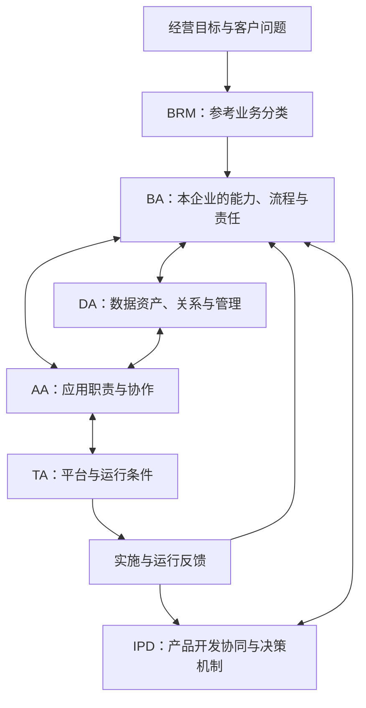

# 企业数字化：IPD、BRM 与 4A 架构

一家工业设备企业准备推出新产品，同时要改造研发、供应链和售后系统。它会遇到三类问题：产品是否值得投入、企业需要哪些业务功能、这些业务如何由信息和系统支撑。IPD、BRM、4A 分别从不同角度帮助回答这些问题。

本文的 **BRM 指业务参考模型（Business Reference Model）**。概念依据公开一手资料；组合方式、交付物建议和工业设备场景是自主分析与教学设计，不是某家企业的实施实录。

## 1. 先看区别

| 维度 | IPD | BRM | 4A 架构 |
|---|---|---|---|
| 中文名称 | 集成产品开发 | 业务参考模型 | 业务、数据、应用、技术四个架构域（TOGAF 口径） |
| 核心定位 | 产品开发与生命周期协同、治理机制 | 描述和分类业务功能、服务的参考模型 | 业务、数据、应用、技术的架构内容及其关联 |
| 主要问题 | 如何把需求转化为产品，并组织开发、评审和交付？ | 企业做哪些事？哪些功能重复、缺失或可以共享？ | 业务怎样运行，需要什么数据、应用和技术支撑？ |
| 关注对象 | 产品、开发活动、参与角色、交付物与决策 | 业务领域、功能、服务及其分类定义 | 战略与业务运作、数据资产、应用系统、技术能力 |
| 可形成的成果 | 开发流程、角色职责、评审规则、交付物要求 | 业务分类目录、功能定义、业务映射 | 架构模型、关联矩阵、现状与目标差距、演进安排 |
| 适用范围 | 产品开发相关的跨部门活动 | 企业或行业的业务分类与比较 | 企业整体或选定业务范围的数字化设计 |

**三者可以配合使用。BRM 可为业务架构提供参考输入；IPD 为产品开发规定工作和决策机制；4A 把这些业务要求联系到数据、应用和技术设计。** 后两句话是本文的组合分析，不是三个概念之间强制规定的实施顺序。

## 2. IPD：让产品开发成为跨部门的经营活动

IBM Research 将 IPD 描述为用于开发硬件、软件和服务的企业级流程，其高层定义涉及业务目标、治理、流程结构、参与角色与交付物。[IBM Research，2011](https://research.ibm.com/publications/concepts-in-the-definition-of-an-enterprise-development-process)

据此理解，IPD 的范围超出研发部门内部的任务管理。产品从需求走向交付，需要把市场判断、开发可行性和相关部门的准备情况放在一起讨论。

以下是用于理解 IPD 的设计问题，不是 IBM 或华为的统一流程模板：

- **需求与商业判断**：客户问题是否明确，产品价值与投入假设是否有证据？
- **跨部门协同**：研发、市场、财务、采购、制造、服务等参与者分别承担什么责任？
- **阶段决策**：何时继续投入、调整范围或停止？什么证据支持决定？
- **交付准备**：技术完成后，生产、供货、销售与售后是否也具备条件？
- **生命周期反馈**：上市后的质量、成本和客户反馈如何进入后续改进？

实施时可以把阶段、角色、交付物和决策权明确下来，再选择系统支撑。采购项目管理或产品生命周期管理软件，不能自动建立这些机制。软件团队也可在开发活动中采用迭代方式；如何与经营评审衔接，需要结合自身节奏设计。

## 3. BRM：以业务功能建立共同语言

美国 OMB 的《联邦企业架构框架 v2》将 BRM 定义为业务功能与服务的分类体系，并强调以业务功能而非组织部门观察业务。它可帮助识别共享、重复建设和投资关联。[FEAF v2，2013，第 14—17 节](https://obamawhitehouse.archives.gov/sites/default/files/omb/assets/egov_docs/fea_v2.pdf)

这种参考思想迁移到企业时，可以帮助不同部门用同一套业务名称讨论工作。例如，多个事业部都开展“供应商管理”，但组织归属和系统可能不同。把它们映射到共同定义，才能进一步判断哪些内容相同、哪些有业务差异。

**参考模型需要结合企业实际裁剪。** 美国联邦政府的具体分类不是制造企业的通用目录；不同来源的 BRM 也不能默认拥有相同层级和定义。

下面是工业设备企业的教学分类，未作为行业标准核验：

| 示例业务领域 | 示例功能 | 要进一步澄清的边界 |
|---|---|---|
| 产品与研发 | 需求管理、产品规划、研发管理 | 需求来源、产品范围、研发与技术预研的区别 |
| 供应与制造 | 供应商管理、采购、生产、质量管理 | 供应商准入与订单执行的分工 |
| 销售与服务 | 商机管理、订单管理、售后服务 | 商机到订单、交付到服务的衔接 |
| 经营支撑 | 财务、人力、信息技术管理 | 共享服务与事业部专属服务的边界 |

BRM 不等于组织架构图，也不等于完整业务架构。参考分类之外，企业还要定义自身目标、价值流、流程、责任、业务规则和绩效要求。业务功能描述“做什么”；流程描述工作的顺序、条件与协同。二者需要建立映射，不能直接互换。

## 4. 4A：按 TOGAF 的四个架构域理解

本文将“4A”作为四个架构域的中文讨论简称。**TOGAF 对应的是 Business、Data、Application、Technology Architecture，即业务架构、数据架构、应用架构、技术架构（BA／DA／AA／TA）**。四个域是企业架构内容的划分，TOGAF 还提供架构开发方法、内容组织与治理指导。[The Open Group：TOGAF 与 ArchiMate 的关系](https://help.opengroup.org/hc/en-us/articles/32115987894930-How-the-ArchiMate-Language-and-the-TOGAF-Standard-Complement-Each-Other)

### 4.1 四个域分别描述什么

TOGAF 的业务架构涉及战略、治理、组织和关键业务流程；数据架构涉及逻辑与物理数据资产及数据管理资源；应用架构涉及应用系统、系统间交互及其与业务的关系。[The Open Group：TOGAF ADM and MDA，历史概念说明](https://www.opengroup.org/cio/MDA-ADM/)

技术架构关注支撑业务、数据和应用服务所需的软件与硬件能力及基础设施。它需要将应用需求联系到技术组件、平台服务和相关质量要求。[The Open Group：Using TOGAF for Enterprise SOA，Phase D](https://www.opengroup.org/soa/source-book/togaf/p4.htm)

下表的设计问题、模型选择与工业设备例子是本文的自主整理，不是标准要求每个项目必须交付的完整清单。

| 架构域 | 主要设计问题 | 可选的模型与记录 | 工业设备场景举例 |
|---|---|---|---|
| BA：Business Architecture，业务架构 | 为实现战略和业务目标，组织如何运作、治理并交付价值？ | 能力、价值流、组织与角色、流程及业务规则 | 新品上市的目标、研发与制造职责、交付流程和决策责任 |
| DA：Data Architecture，数据架构 | 需要哪些数据资产，它们如何组织、关联与管理？ | 数据实体与关系、逻辑及物理结构、数据流、管理责任与迁移约束 | 需求、产品版本、物料和客户设备的标识、关系及管理机制 |
| AA：Application Architecture，应用架构 | 应用如何支持业务和处理数据，系统之间怎样协作？ | 应用组合、职责边界、服务、接口和交互关系 | 研发、采购、制造和售后系统的分工及集成 |
| TA：Technology Architecture，技术架构 | 哪些技术能力、平台和基础设施支撑业务、数据与应用？ | 平台服务、技术组件、软件硬件基础设施、网络与部署约束 | 支撑版本查询和系统集成的运行环境，以及可用性和恢复能力 |

四个域之间存在内容关联，也需要协调治理边界。例如，产品版本在 BA 中具有业务含义，在 DA 中成为数据实体；AA 说明哪个应用维护它，TA 说明如何支撑该应用运行。不能据此认为一个业务对象只能出现于一个域。

### 4.2 数据架构、信息架构与信息系统架构

**本文以 DA 为主，不再用 IA 替代 TOGAF 的数据架构域。** 华为公开材料中的 IA（Information Architecture，信息架构）是另一种企业架构表述，迁移时需要核对覆盖范围。[华为，2023](https://e.huawei.com/cn/news/2023/solutions/wan/build-advanced-digital-infrastructure)

另一个容易混淆的术语是 **Information Systems Architectures（信息系统架构）**：在 TOGAF ADM 的阶段 C 中，它包括 **Data Architecture 和 Application Architecture**，不是一个与 BA、DA、AA、TA 并列的第五个域，也不等于前述 IA。

数据架构的范围超过数据库表设计，还涉及数据资产和管理资源；技术架构也超过服务器采购，需要明确支撑应用和数据运作的技术能力。

### 4.3 四个架构域与 ADM 的关系

四个域回答“描述什么”，ADM（Architecture Development Method，架构开发方法）指导“如何开发和治理架构”。以下是方法的简化导航，不能替代完整标准。

| ADM 部分 | 核心工作 | 与四个域的关系 |
|---|---|---|
| 预备阶段（Preliminary） | 建立架构能力，裁剪方法与约定原则 | 为架构工作提供组织和治理基础 |
| A：Architecture Vision | 明确范围、利益相关者、价值与架构愿景 | 确定本次架构工作的目标和边界 |
| B：Business Architecture | 开发业务架构 | BA |
| C：Information Systems Architectures | 开发数据与应用架构 | DA 与 AA |
| D：Technology Architecture | 开发技术架构 | TA |
| E：Opportunities and Solutions | 形成实施方案与过渡安排 | 整合各域的差距及候选工作 |
| F：Migration Planning | 制定实施与迁移计划 | 将架构演进安排为可执行的计划 |
| G：Implementation Governance | 治理实施与架构的一致性 | 检查实施是否满足架构要求 |
| H：Architecture Change Management | 管理架构变化 | 根据变化维护和演进架构 |
| Requirements Management | 持续管理架构需求 | 贯穿 ADM，支持各阶段处理需求变化 |

阶段 B、C、D 的分工，以及后续规划、实施治理和变更管理可参见 [The Open Group 的官方说明](https://help.opengroup.org/hc/en-us/articles/32115987894930-How-the-ArchiMate-Language-and-the-TOGAF-Standard-Complement-Each-Other)。方法裁剪、迭代及贯穿周期的需求管理可参见 [TOGAF Enterprise Architecture Practitioner 能力说明](https://help.opengroup.org/hc/en-us/articles/32127544219026-Competency-to-Role-Mapping-TOGAF-Enterprise-Architecture-Practitioner)。

ADM 需要结合范围和环境裁剪、迭代。不能把 BA→DA→AA→TA 当成固定的一次性交接流水线，也不能从阶段 C 同时涵盖 DA 与 AA，推导出必须先完成所有数据设计再进行应用设计。

### 4.4 从架构描述到演进与治理

以下是结合上述方法的实践整理：

- **比较现状与目标**：在选定范围内记录基线架构（Baseline）和目标架构（Target），明确差距。
- **安排过渡**：当目标无法一次实现时，描述必要的过渡架构（Transition）及对应工作安排。
- **保持可追溯关系**：将业务目标、架构需求、各域设计决定和实施工作联系起来。
- **验证实现**：在实施与运行中核对架构要求，并通过变更管理修订架构。

例如，业务要求可追踪产品变更，需要在 DA 中定义关联与记录要求，在 AA 中明确维护和查询职责，在 TA 中落实运行条件，并在实施中验证这些要求是否满足。安全、隐私和治理要求贯穿各域。四张图的完整度不能单独证明企业数字化的成效。

## 5. 同一场景中如何配合

> **教学／设计示例**：以下为假设企业的自主设计，不是 IBM、华为或其他企业的真实落地案例。

新产品上市前出现三个问题：各部门使用不同的需求编号，研发已完成但制造准备不足，售后无法定位客户设备对应的产品版本。

| 问题 | 运用的视角 | 示例处理 |
|---|---|---|
| 部门对“需求管理”的理解不同 | BRM 与 BA | 对齐业务功能定义，再明确本企业的流程和责任 |
| 研发完成被当成上市完成 | IPD | 在交付决策中要求相关部门提供准备情况与风险证据 |
| 需求、版本和客户设备缺少关联 | DA | 定义对象标识、关系、版本与信息管理责任 |
| 信息重复录入、系统职责冲突 | AA | 明确负责管理信息的应用及同步、查询接口 |
| 跨系统记录不可恢复或访问失控 | TA 及跨视角治理 | 落实身份权限、日志、备份恢复与运行要求 |

图中关系是本文的组合示意，不是 TOGAF 官方 ADM 图或完整方法流程。IPD 在这里为产品开发相关的业务设计提供机制要求；不能据此把 IPD 当作整个 BA，也不能认为所有业务都必须通过 IPD 管理。

## 6. 如何选择切入点

以下为实践建议，需要用实际问题验证：

- **业务名称和范围混乱、难以比较系统投资**：先用 BRM 思路对齐分类，再建立企业自己的业务定义与映射。
- **产品开发中责任断裂、评审缺少决策依据**：先明确 IPD 相关机制，识别哪些协作问题需要流程或系统改变。
- **系统重复、数据口径冲突、变更影响不清**：围绕一条具体价值流开展 4A 分析，建立业务、数据、应用和技术之间的关联。

不必先完成全企业建模才能改进。可以选一个有明确目标和负责人的业务范围，记录现状、问题、设计决定和验证指标，再逐步扩展。不能仅用模型数量、图的完整度或文档页数评价成效。

## 7. 与 AI 知识库、知识本体的联系

以下是面向 AI 应用的自主分析：

| 材料 | 可提供的知识 | 进入知识库时需补充的约束 |
|---|---|---|
| BRM | 业务分类与术语参考 | 来源版本、企业裁剪记录，区分参考项与实际业务 |
| IPD | 工作规则、角色、交付物和决策要求 | 适用产品与阶段、生效日期、批准来源、例外规则 |
| 4A | 流程、对象、应用与技术之间的关系 | 现状／目标标记、版本、负责人和关系来源 |

知识本体可以进一步定义其中对象、关系、状态与规则的语义；知识图谱可以保存具体事实和关联。三者的文档也可以作为检索材料，但未经审核的设计建议不能直接成为 Agent 的执行规则。架构描述本身不授予访问权限或业务操作权。

[摘要](摘要.md) · [来源与适用边界](来源与适用边界.md) · [返回跨企业专题](../README.md)

跨项目相关主题：[`knowledge.kb-graph-ontology`：知识库、知识图谱与本体](https://github.com/yujianggu/kb/blob/main/知识库/知识库知识图谱与本体/README.md)。相关推荐不自动展开。
